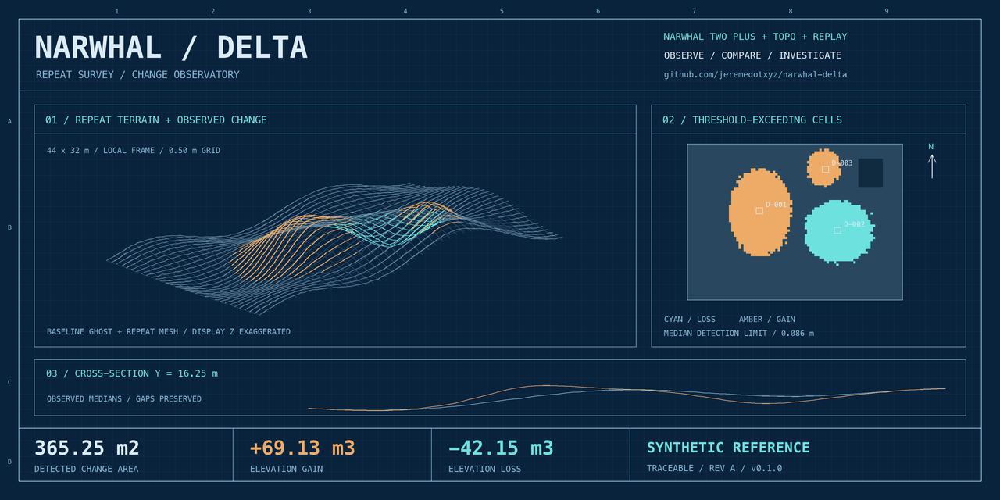
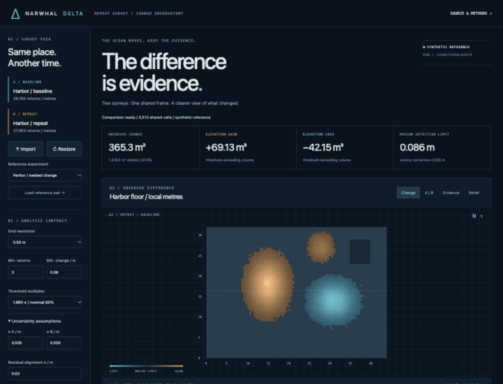
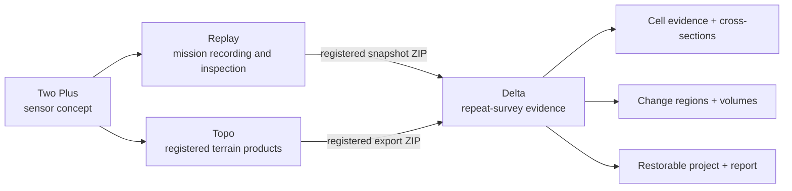

<div align="center">

# NARWHAL / DELTA

### The ocean moves. Keep the evidence.

**Repeat-survey change detection · uncertainty-aware measurements · reproducible investigations**

[](https://github.com/jeremedotxyz/narwhal-delta/actions/workflows/checks.yml)


[Start here](#-launch-the-observatory) · [Methods](docs/methods.md) · [Operator guide](docs/operator-guide.md) · [Technical report](docs/technical-report.md) · [Verification](docs/verification.md)



</div>

**Narwhal Delta compares two surveys of the same place and makes the evidence behind every reported change inspectable.** Import registered survey points, compute a shared-grid elevation difference, separate supported changes from missing coverage and uncertain cells, and export a complete investigation that another person can restore and recompute.

A repeat survey with a 12 cm height bias can look like a changing seabed. A coverage hole can look like a missing structure. Delta keeps those cases separate: no hidden gap filling, no automatic coordinate guessing, no unexplained black-box registration.

> **Engineering reference / alpha.** The shipped experiments are synthetic. Numerical tests and passing CI do not establish physical sensor accuracy, hydrographic certification, navigational fitness, independent peer review, or compliance with IHO/ISO standards. No third-party certification is claimed. See the [verification ledger](docs/verification.md).

## 🧭 What you can do

| Investigation | Working capability | Evidence retained |
| :-- | :-- | :-- |
| Compare repeat surveys | Shared origin-anchored grid, per-cell medians, B − A elevation | Cell coordinates, A/B elevations, return counts, difference, threshold and classification |
| Understand coverage | Separate A-only, B-only, insufficient-return and outside-ROI states | No missing cell is silently counted as gain or loss |
| Test uncertainty | Survey floors, robust cell roughness, residual alignment uncertainty, minimum-change floor | Exact settings and per-cell conditional detection limits |
| Investigate alignment | Manual XY/Z/yaw correction of B; optional stable-control vertical fit | Applied parameters, control-cell count, correction and residual control roughness |
| Inspect change | Plan change map, before/after divider, evidence-ratio view, oblique relief | Synchronized cell inspector and east/west cross-section |
| Find connected changes | Four-neighbour gain/loss regions, area, volume and peak | Region IDs, locations, signed volumes and component bounds |
| Leave a field note | Pin a text annotation to a selected cell location | Coordinates and escaped text in the project bundle and report |
| Share the investigation | Report HTML, vector SVG, numerical CSV, checksummed project ZIP | Normalized input surveys, result, settings, notes and SHA-256 manifest |
| Work without a browser | CLI analysis and seeded reproduction script | Same comparison engine and evidence format |



## 🚀 Launch the observatory

**Requirements:** Python 3.10 or newer; a current browser with Canvas, native dialog and ResizeObserver support. Node.js is used only for the optional JavaScript syntax check. The application has **zero third-party Python runtime dependencies**. Internet access is needed for cloning and potentially the initial Python build tooling, not for survey analysis.

```bash
git clone https://github.com/jeremedotxyz/narwhal-delta.git
cd narwhal-delta
python3 -m venv .venv
source .venv/bin/activate
python -m pip install .
python -m narwhal_delta serve
```

Open **[http://127.0.0.1:8768/](http://127.0.0.1:8768/)**. A seeded harbor comparison is already loaded. You do not need a sensor, cloud account, API key, database or GPU.

On Windows, activate with `.venv\Scripts\Activate.ps1` and use `python` if `python3` is unavailable. The implementation uses portable standard-library APIs, but the published CI currently tests Ubuntu/Python 3.10 and 3.12; Windows is not a separately validated platform.

For a different port:

```bash
python -m narwhal_delta serve --port 8770
```

The server intentionally binds to loopback. Keep the terminal process running while using the workbench. Stop with `Ctrl+C`. **Projects live in memory:** export an evidence bundle before stopping, restarting, or loading a new reference pair. Refreshing the page reconnects to the current process; restarting the process loads the reference experiment again.

For source development, either reinstall after Python changes or run from the checkout:

```bash
PYTHONPATH=src python -m narwhal_delta serve --port 8768
```

### A first investigation in five minutes

1. Leave **Harbor / seabed change** selected. Inspect the cyan loss and amber gain patches. The hatched corner is single-survey coverage, not erosion.
2. Select **A / B**, move the divider, then choose **Evidence** to inspect the ratio of change magnitude to the operative threshold. Return to **Change** for signed classifications.
3. Click a cell, or use the map's arrow keys, and read its elevations, return counts and detection limit. Locate a connected region from the findings table.
4. Move the northing slider through the feature. The cross-section shows observed A/B elevations and preserves gaps.
5. Change an uncertainty floor or minimum-change value, then select **Compute difference**. Exports are disabled while controls differ from the displayed result.
6. Add an inspection note. Download **Evidence bundle**, then use **Restore** to verify it can be recomputed.
7. Load **Control / no change**, then **Alignment / +0.12 m bias**. On the latter, expand alignment, enable the default stable-control box `[0,0,44,5]`, and compute again. The deliberate bias disappears within the configured threshold.

On narrow screens, **Analysis parameters / expand** reveals the analysis controls. On desktop they remain visible in the sidebar.

## 🔬 What the numbers mean

Delta uses **positive-up elevation**: `Δz = z_repeat − z_baseline`.

- Positive change is **elevation gain**. Negative change is **elevation loss**. These labels do not establish sediment type, erosion mechanism, mass, object identity or cause.
- Both inputs are binned directly into one origin-anchored metre grid. Empty cells remain empty; there is no interpolation or extrapolation.
- Each sufficiently sampled shared cell gets a median elevation and `1.4826 × MAD` roughness proxy for each survey.
- The difference uncertainty proxy combines A/B survey floors, A/B roughness and residual alignment uncertainty in quadrature. Roughness is **not divided by √n**: repeated returns are not assumed independent.
- The operative detection threshold is the larger of the minimum-change floor and the selected multiplier times that proxy. **Strict exceedance** is required. “Nominal 95%” is conditional on a suitable Gaussian error interpretation; it is not a measured field confidence or multiple-testing correction.
- Gain and loss volumes integrate **only threshold-exceeding cells**. Raw net volume includes all sufficiently sampled shared cells. Those quantities answer different questions and are exported separately.
- The summed threshold-volume envelope is a **sensitivity envelope**, not a confidence interval for integrated volume. Delta does not estimate spatial covariance.

Full equations, operation order, edge behavior and counterexamples: **[Methods and uncertainty](docs/methods.md)**.

## 📥 Bring your own survey pair

Both surveys must already share an origin, axes, scale, vertical datum and positive-up convention. Matching text labels alone cannot prove that they do. Delta rejects unequal frame/datum declarations and does not infer CRS conversions, tidal corrections, refraction correction, pose registration or geodetic transforms.

| Input | Required content | How frame/datum are supplied |
| :-- | :-- | :-- |
| CSV | UTF-8 `x,y,z` headers, finite metres, positive Z up; optional integer `quality` | Import dialog or CLI arguments |
| Survey JSON | `schema: narwhal.survey/1`, declarations, `[x,y,z]` points | JSON document itself |
| Topo/Replay snapshot ZIP | Root `metadata.json` + `points.csv`; registered frame | Import dialog or CLI; embedded frame must be registered |
| Delta evidence ZIP | All project members and matching checksums | **Restore**; embedded declarations and settings |

Accepted snapshot frame markers: `MAP_ENU`, `POSE_REGISTERED`, `ENU`, `LOCAL_ENU`. `SENSOR_LOCAL` is refused. ENU is a frame **type**, not a unique shared origin; still supply your exact common frame ID and datum. For Replay, export **Snapshot ZIP**, not a raw MCAP mission or `.narwhal.zip` recording archive.

CSV quality bits 1/2/8 are filtered, consistent with the existing Narwhal point-export convention; bit 32 marks synthetic input. Other bits remain accepted, so externally assess timing/synchronization quality. CSV without quality flags is treated as operator supplied unless you select the synthetic-source checkbox. JSON must explicitly provide a Boolean synthetic flag if applicable; its declarations take precedence over dialog values.

### Minimal analytic example

The repository includes a four-cell pair with known gain, loss and unchanged cells:

```bash
python -m narwhal_delta compare \
  examples/minimal-before.csv examples/minimal-after.csv \
  --frame-id EXAMPLE-LOCAL-v1 \
  --vertical-datum SYNTHETIC-ZERO \
  --settings examples/settings.json \
  --output minimal-evidence.zip
```

Expected: **2 m³ gain, 1 m³ loss, +1 m³ thresholded net**, over 4 m² of shared coverage and 3 m² of detected change. Inputs carry synthetic quality flags. Open `report.html` inside the resulting ZIP. Do not interpret the toy example as sensor data.

For a vendor point cloud, export already registered metre XYZ CSV first. LAS/LAZ, GeoTIFF, raw MCAP and arbitrary vendor archives are not direct inputs in v0.1. No EPSG assignment or coordinate conversion is implied.

See **[data contracts](docs/data-contracts.md)** for JSON examples, every parameter, API operations, bounds, coordinate conventions, checksum semantics and archive layout.

## 🧪 Reproduce the evidence

```bash
python -m unittest discover -s tests -v
python examples/reproduce.py
node --check src/narwhal_delta/web/app.js
```

The reproduction script writes `runs/reference-results.json` and a restorable `runs/harbor-evidence.zip`. `runs/` is ignored by Git. A recorded reference result is committed in [`examples/reference-results.json`](examples/reference-results.json).

| Synthetic experiment | Observed result at default 0.50 m settings |
| :-- | --: |
| Harbor shared cells | 5,512 |
| Harbor shared area | 1,378.00 m² |
| A-only coverage gap | 120 cells / 30.00 m² |
| Threshold-exceeding area | 365.25 m² |
| Elevation gain volume | +69.1278 m³ |
| Elevation loss volume magnitude | 42.1474 m³ |
| Thresholded net volume | +26.9804 m³ |
| Raw net volume | +30.4170 m³ |
| Median operative detection limit | 0.08605 m |
| Mean absolute Δz error against constructed truth | 0.00845 m |
| No-change experiment | 0 threshold-exceeding cells |
| Injected +0.12 m bias / no alignment | 1,397.75 m² apparent change |
| Stable-control correction | −0.119155 m from 880 cells |
| Bias experiment / after correction | 0 threshold-exceeding cells |

These are **numerical results on seeded constructed terrain**, not measured underwater accuracy. Exact floating-point fingerprints may differ across numerical environments; retain the source commit and exported input points with your evidence. See the [verification ledger](docs/verification.md) for tested behaviors, acceptance criteria and remaining gaps.

## 📦 An investigation you can inspect

```text
narwhal-delta-evidence.zip
├── before.json          Normalized full baseline point survey + source provenance
├── after.json           Normalized full repeat point survey + source provenance
├── result.json          Settings, alignment, cells, regions, warnings, run identity
├── cells.csv            All occupied cells; nulls are blank, never fabricated zeros
├── change-map.svg       Shareable vector plan map with accessible description
├── report.html          Printable stand-alone report, methods, notes and provenance
├── annotations.json     Inspection note locations and text
├── README.txt           Interpretation and archive notes
└── SHA256SUMS           SHA-256 for every other member
```

The project run ID hashes normalized survey identities, settings and Delta version. Source file SHA-256 values record input provenance; original source file bytes are not copied into normalized input JSON. Restore checks member hashes, rebuilds the comparison and verifies its run ID before replacing the current project. A checksum is integrity evidence, not an author signature.

Bundle bytes are deterministic for identical inputs, results and annotations in the same environment. Annotations do not alter the numerical run ID. The source commit is deliberately recorded separately from that ID; archive both when reporting research.

## 🗺️ The Narwhal stack



[Two Plus](https://github.com/jeremedotxyz/narwhal-two-plus) describes the sensor concept. [Topo](https://github.com/jeremedotxyz/narwhal-topo) reconstructs terrain. [Replay](https://github.com/jeremedotxyz/narwhal-replay) records and inspects mission streams. **Delta compares two registered observations.** The integration here is a documented file contract, not a live device driver or automatic fleet connection.

## 📚 Documentation library

| Document | Contents |
| :-- | :-- |
| [Operator guide](docs/operator-guide.md) | Installation, first run, import, alignment, inspection, saving, restore and troubleshooting |
| [Methods](docs/methods.md) | Grid equations, median/MAD estimator, uncertainty, strict thresholds, volumes and alignment |
| [Technical report](docs/technical-report.md) | Abstract, design rationale, controlled experiments, results, discussion and limitations |
| [Data contracts](docs/data-contracts.md) | Survey/CSV/ZIP schemas, settings, result fields, API and resource bounds |
| [Architecture](docs/architecture.md) | Modules, data flow, local security boundary, transactions and lifecycle |
| [Verification ledger](docs/verification.md) | Meaningful test evidence, manual UI checks, status and unverified domains |
| [Roadmap](docs/roadmap.md) | Specific research and engineering improvements; no implied delivery dates |
| [Security](SECURITY.md) | Loopback scope, archive validation, private coordinates and checksum limits |
| [Contributing](CONTRIBUTING.md) | Numerical review expectations, reproduction and honest badges |
| [Changelog](CHANGELOG.md) / [Citation](CITATION.cff) | Release history and machine-readable software citation |

### Repository map

```text
src/narwhal_delta/
  model.py       Finite, bounded survey and settings contracts
  ingest.py      CSV, survey JSON and registered snapshot readers
  demo.py        Seeded analytic reference surveys
  engine.py      Common grid, correction, thresholds, components, sections
  export.py      Reproducible ZIP, checksum restore, CSV, SVG and report
  server.py      Single-project loopback HTTP workbench
  cli.py         serve / demo / compare commands
  web/           Responsive, buildless Canvas interface
examples/        Tiny analytic CSV pair + settings + reference reproduction
scripts/         Data-derived blueprint artwork generator
tests/           Numerical, data-contract, archive and HTTP regression checks
.github/         CI, reproducibility artifacts and contribution templates
```

### Scope and bounds

Maximum 200,000 accepted points per survey, 80,000 combined occupied cells and 80,000 cells in the bounding rectangle. Input files are limited to 32 MiB; ZIP expanded content is also limited to 32 MiB, with at most 32 members for snapshot imports. Evidence exports exceeding the restorable expanded-size profile are refused with a crop/reduce instruction. These are bounded engineering workflows, not an out-of-core national mapping engine.

The comparison is a **2.5D elevation surface**. Overhangs, walls, mixed bottom/object returns and multi-layer scenes can violate that model. Survey registration, tide/datum correction, water-column optics, calibrated sensor uncertainty and spatially correlated volume error remain external responsibilities. See [limitations](docs/technical-report.md#limitations-and-threats-to-validity).

### Artwork, badges and licensing

The 1280 × 640 share card is generated from the actual seeded harbor comparison, with real cell classes, cross-section geometry and measured reference summary values. Its editable vector source is included. Regenerate with Python + Pillow:

```bash
python -m pip install 'Pillow>=10,<13'
python scripts/generate_social_preview.py
```

The CI badge links to actual repository checks. Other badges describe version, runtime and the synthetic-validation scope; **none is a certification**. This repository has no license grant selected by its owner. Public visibility does not itself grant an open-source license.

### Technical foundations

Delta independently implements median surface differencing and a documented conditional threshold model. Its error-propagation rationale is informed by the [GCD project's primary documentation](https://gcd.riverscapes.net/Concepts/error-propagation/), while the treatment of correlated/systematic errors follows the cautions discussed in [Anderson (2019), USGS](https://www.usgs.gov/publications/uncertainty-quantitative-analyses-topographic-change-error-propagation-and-role). This is not GCD, M3C2, an IHO-certified hydrographic system or a claim of methodological equivalence to those tools.

---

**Observe → Compare → Investigate.** Keep the assumptions with the result.
