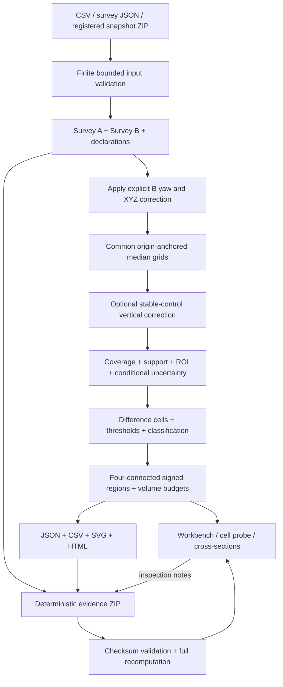

# Architecture

## Design intent

A comparison should be explainable down to a cell, reproducible from portable inputs, and useful without a cloud account. Delta therefore uses a small standard-library Python engine and a buildless Canvas workbench. Scientific state lives on the Python side; the browser draws results and submits explicit settings. No computation depends on a screenshot, browser-only interpolated surface or generated artwork.

## Module responsibilities

| Module | Owns | Does not own |
| :-- | :-- | :-- |
| `model.py` | Survey/settings types, finite values, metre bounds, normalized document identity | CRS conversion or calibration |
| `ingest.py` | CSV parsing, survey JSON schema marker, bounded registered snapshot adapter | Vendor stream drivers or raw MCAP decoding |
| `demo.py` | Seeded constructed baseline, analytic change and bias/null scenarios | Physical sensor simulation or measured truth |
| `engine.py` | Rigid B correction, median/MAD grids, stable-control fit, thresholds, regions, sections | Point cloud ICP, probabilistic posterior or causal classification |
| `export.py` | CSV/SVG/report, deterministic ZIP/checksums, safe restore parsing | External data publication or authenticated signatures |
| `server.py` | One process-local project, atomic computation commits, fixed HTTP routes | Multi-user authentication, database or background mission recorder |
| `cli.py` | `serve`, `demo`, `compare` argument handling | Alternative numerical engine |
| `web/app.js` | Form state, stale controls, Canvas map/section drawing, file selection and downloads | Hidden independent analysis or geodetic assumptions |

Python modules import only the standard library. `scripts/generate_social_preview.py` optionally uses Pillow for rendering a PNG; SVG geometry is generated in the same script from the actual reference result. Build tooling uses setuptools. Node is needed only for syntax verification, not at runtime.

## State, transactions and concurrency

`State` holds A, B, settings, current result and up to 100 annotations. Comparison actions first compute local candidate values. Only successful validation/computation assigns the new project state. Invalid settings, control fits and restore failures preserve the previous valid result. Importing a valid survey with mismatched frame/datum is a deliberate staging transition: the new input is retained, but `result` becomes null and exports are refused until a matching pair is supplied.

A process lock serializes state reads, computations, mutations and artifact generation. The threaded HTTP server can accept multiple connections, but project operations are serialized. This is intentionally one user's workbench. All tabs attached to the same process share the same project; the UI prevents overlapping mutations from its own tab, but does not implement multi-client revision conflict resolution.

The browser disables artifact links when form controls differ from the current result, when a request is active, or when no comparable pair exists. Exports use the server's committed state, never unsent form values. Inspection view changes do not alter the numerical run ID. Loading a new scenario resets settings and notes; parameter recomputation preserves notes at their fixed coordinates.

State is not saved automatically. No source files are modified by analysis. Export creates a self-contained portable snapshot; stopping the process discards unsaved state. This is explicit to avoid suggesting a durable mission library where none exists.

## Resource model

Gridding and median sorting are in memory. A survey is limited to 200,000 points and finite coordinate bounds. The combined occupied-cell count and full bounding-rectangle cell count are each limited to 80,000. This bounds output size and prevents enormous empty display extents. Raw input and expanded snapshot/project archives use a 32 MiB bound. Some valid large input pairs can produce an evidence bundle above this profile; export refuses those rather than emitting an archive that cannot be restored. Crop or reduce source inputs reproducibly for larger jobs.

Canvas rendering draws one tile per occupied cell. At the supported upper bound this can be slower on phones. The UI is responsive but not a tiled GPU point-cloud engine. Server work remains CPU-bound Python; no throughput promise or maximum-dataset benchmark is claimed.

## Local boundary

The server binds only to `127.0.0.1`. Requests need an allowed loopback Host and, when present, same-loopback Origin. Mutations require JSON; there is no arbitrary filesystem read, URL fetch, code execution or shell endpoint. Static assets are an allowlist packaged in the wheel. The application uses no external fonts, analytics or CDN requests during analysis. Response headers include no-store caching, nosniff and a same-origin content security policy.

File uploads are deliberate local selections, base64-encoded for a bounded JSON request. ZIPs are inspected without extracting paths. HTML exports escape names and note text. Those measures limit routine accidental exposure and injection, but are not a penetration test or formal audit. Another local process is not excluded by authentication. See [SECURITY.md](../SECURITY.md).

## Integration boundary

Topo and Replay integration is a static registered point-export contract. Delta imports the accepted point CSV and reconstructs its own common grids. It does not reach into another server, scrape a Topo canvas, modify upstream source, infer device accuracy or drive a laser. Raw recording inspection remains Replay's responsibility. Pose/optical corrections and consistent frame/datum establishment happen before Delta.

## Reproducibility boundary

Run identity captures normalized input documents, settings and the semantic software version. Checksum manifests capture the bytes of portable evidence members. The repository commit identifies exact source code and must be retained separately. Integrity and reproducibility are related but not identical: a valid checksum does not prove independent calibration, and a deterministic computation can still use a wrong datum or unsuitable error model.
